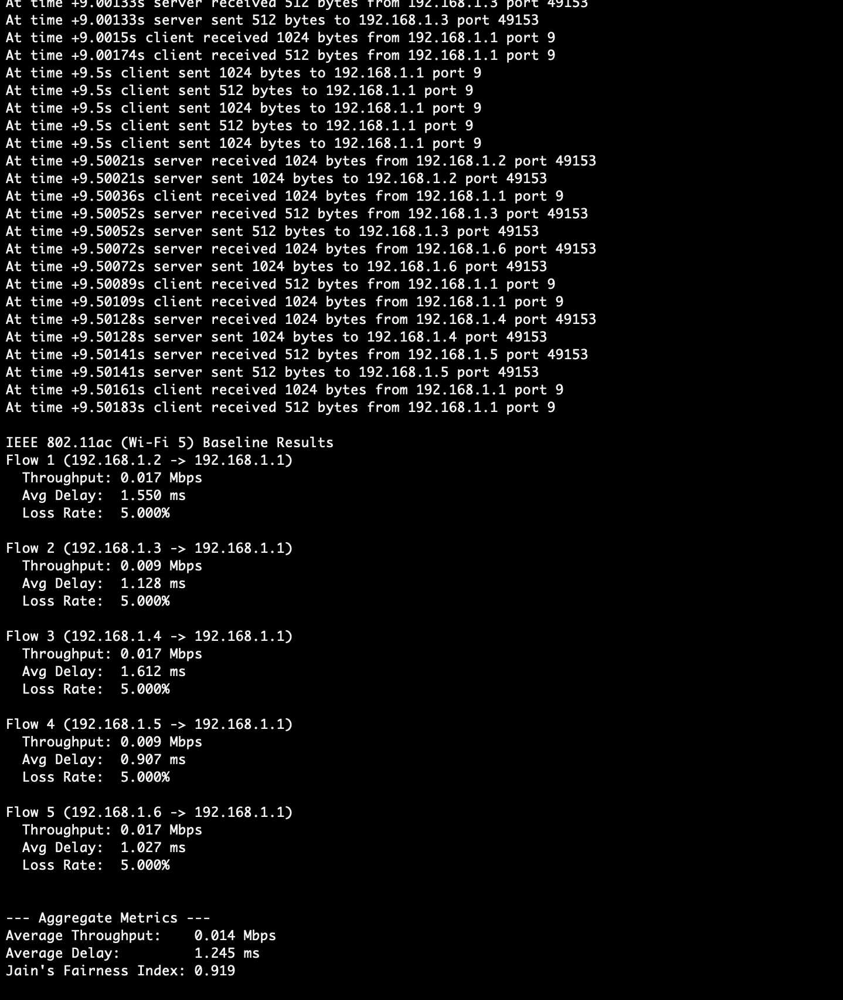
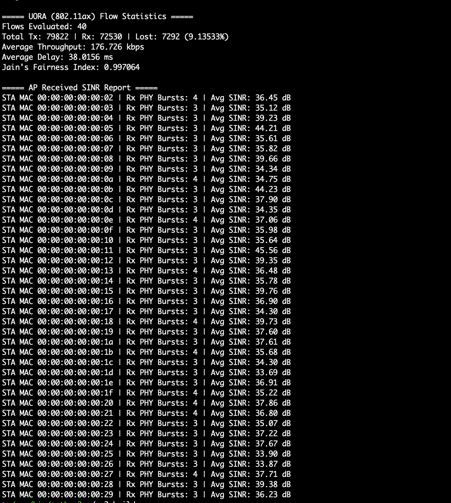
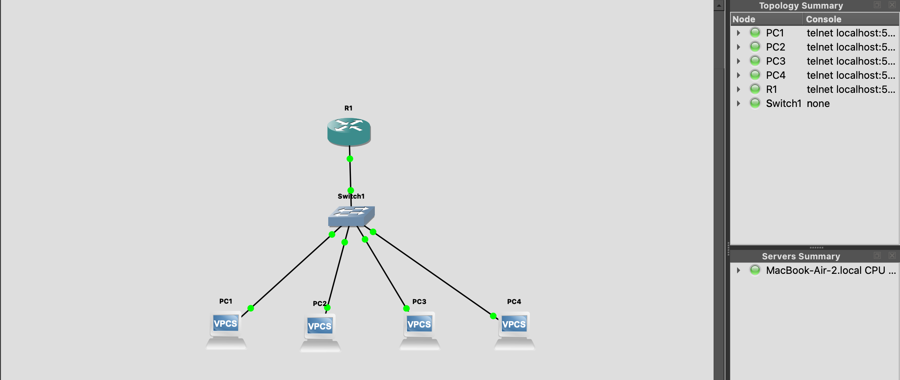
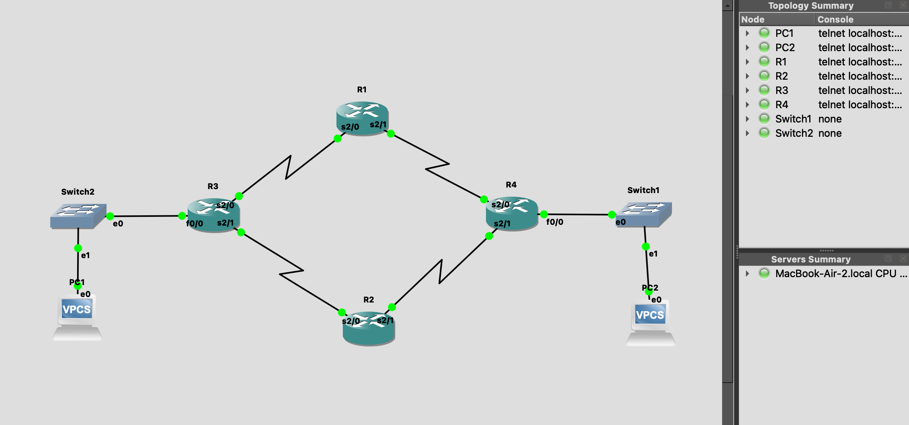

# Computer Networks

Three practical assignments completed for the **Computer Networks** course at the **University of Tehran**.

The projects cover TCP socket programming, wireless-network simulation with ns-3, and network emulation with GNS3. The repository includes C++ source code, simulation results, router configurations, topology files, and reports.

## Projects

| Assignment | Project | Topics |
| --- | --- | --- |
| [CA1](CA1/) | TCP chat application with file-management commands | Client–server sockets, concurrent client handling, public/private messages, and command parsing |
| [CA2](CA2/) | Wireless LAN performance evaluation in ns-3 | Wi-Fi 5/6/7 configurations, sparse and dense topologies, UDP traffic, multi-user scheduling, and flow statistics |
| [CA3](CA3/) | Switching and routing labs in GNS3 | ARP, VLANs, inter-VLAN routing, static routes, backup paths, and OSPF |

## CA1: TCP chat application

A C++ server accepts multiple clients and handles commands for usernames, public messages, private messages, online users, and server-side files. The client connects to **127.0.0.1:8080** and uses a separate receiving thread to display incoming messages.

**Source:** [`server.cpp`](CA1/code/server.cpp) · [`client.cpp`](CA1/code/client.cpp)

**Documents:** [Assignment](CA1/Computer%20Network-%20Programming%2001.pdf) · [Submitted report](CA1/CA1-81010605-810102550/report.pdf)

### Build and run

Requirements: a POSIX environment such as Linux or macOS, a C++17-capable compiler, and thread support.

```bash
git clone https://github.com/mhieir/ComputerNetwork.git
cd ComputerNetwork/CA1/code

g++ -std=c++17 -Wall -Wextra -pthread server.cpp -o server
g++ -std=c++17 -Wall -Wextra -pthread client.cpp -o client

./server
```

In a second terminal, enter the same directory and run:

```bash
./client
```

Enter a username when prompted. Start another client in a separate terminal to try messaging between users.

| Command | Purpose |
| --- | --- |
| `MSG hello everyone` | Send a public message to other connected clients |
| `PM username hello` | Send a private message |
| `USERS` | List other named clients |
| `LIST` | List files in the server's `server_files/` directory |
| `GET filename` | Request the implementation's local download operation |
| `PUT filepath` | Request the implementation's local upload operation |
| `QUIT` | Send the quit command to the server |

The `GET` and `PUT` handlers use `std::filesystem::copy_file` on the server, rather than transmitting file contents over the socket. They assume filesystem paths accessible to the server; this is not a general remote file-transfer implementation. The current client appends its working directory to these commands, so file-path handling may require adjustment for the requested operation.

This is a coursework implementation. Connection cleanup and synchronization of shared client state are areas for further improvement.

## CA2: Wireless LAN simulation

Four ns-3 C++ programs investigate wireless-network behavior under different standards and traffic conditions.

| Program | Configuration |
| --- | --- |
| [`phase1.cc`](CA2/code/phase1.cc) | IEEE 802.11ac baseline with one access point and five stations |
| [`phase2.cc`](CA2/code/phase2.cc) | IEEE 802.11ax comparison using a spectrum PHY and multi-user scheduler |
| [`phase3.cc`](CA2/code/phase3.cc) | Dense IEEE 802.11ax scenario with 40 stations, increased UDP traffic, and PHY tracing |
| [`phase4.cc`](CA2/code/phase4.cc) | IEEE 802.11be configuration for comparison with the dense Wi-Fi 6 scenario |

The programs report flow statistics such as throughput, delay, packet loss, and Jain's fairness index. Parameters such as station count and packet interval are defined in the source.

**Documents:** [Assignment](CA2/Computer%20Network-%20Programming%2002.pdf) · [PDF report](CA2/report.pdf) · [HTML report](CA2/report.html)

### Run in ns-3

Use an ns-3 source tree with the Wi-Fi, spectrum, mobility, internet, applications, and FlowMonitor modules available. The report discusses **ns-3.41**; APIs and supported scheduler attributes can differ between releases.

Copy `phase1.cc` through `phase4.cc` from `CA2/code/` into the ns-3 tree's `scratch/` directory. From the **ns-3 root**, use its CMake-based wrapper:

```bash
./ns3 configure
./ns3 build
./ns3 run scratch/phase1
./ns3 run scratch/phase2
./ns3 run scratch/phase3
./ns3 run scratch/phase4
```

These commands belong in the ns-3 source tree, not the root of this repository. If compilation or attribute configuration fails, check the APIs supported by your installed ns-3 version.

### Scope of the experiments

The report discusses UORA, OFDMA, MU-MIMO, TWT, and MLO. Those discussions should be read alongside the configuration actually implemented in each source file. In particular, the report records a limitation with manual `nRaRus` tuning and uses native scheduler mechanisms instead. Selecting an IEEE 802.11be standard alone does not demonstrate a complete multi-link or TWT experiment.

### Recorded simulation outputs

| Baseline | Dense Wi-Fi 6 |
| --- | --- |
|  |  |

## CA3: Network emulation with GNS3

The GNS3 labs progress from basic switched connectivity to routed networks with redundancy and dynamic route discovery.

| Lab | Work included | Project |
| --- | --- | --- |
| Basic switching | Addressing, ICMP connectivity, and ARP behavior across switches | [`part1.gns3`](CA3/files/part1/part1.gns3) |
| VLANs | VLAN segmentation, an 802.1Q trunk, and router-on-a-stick inter-VLAN routing | [`VLAN.gns3`](CA3/files/VLAN/VLAN.gns3) |
| Static routing | Primary routes, floating backup routes, and link-failure experiments | [`staticRouting.gns3`](CA3/files/staticRouting/staticRouting.gns3) |
| Dynamic routing | OSPF neighbor formation, route learning, and connectivity checks | [Dynamic-routing project](CA3/files/dynamicRouting/staticRouting.gns3) |

The dynamic-routing folder retains the filename `staticRouting.gns3`.

**Documents:** [Assignment](CA3/CN_CA_3.pdf) · [PDF report](CA3/report.pdf) · [HTML report](CA3/report.html)

### Open the labs

1. Install GNS3 with the Dynamips and VPCS components needed by these projects.
2. Configure a compatible Cisco c7200 router image in your GNS3 environment. Local image availability and paths must be configured on your machine.
3. Keep each `.gns3` file with its associated `project-files/` directory, then open the project in GNS3.
4. Resolve any appliance or image-path prompts, start the devices, and inspect their saved configurations.
5. Use the report and screenshots to compare topology, addressing, and routing behavior.

Useful verification commands include:

```text
ping <destination-ip>
show ip interface brief
show ip route
show ip ospf neighbor
show ip ospf database
```

`ping` is available in the VPCS console; the `show` commands are entered on the Cisco routers. Interface names and addresses depend on the selected topology.

### Topology previews

| VLAN routing | Redundant routed network |
| --- | --- |
|  |  |

Generated emulator caches such as `.ghost` files are excluded through `.gitignore`. GNS3 can regenerate runtime artifacts when the environment is configured.

## Repository notes

- `CA1/code/` and `CA2/code/` provide convenient source locations; corresponding submission folders contain additional copies and reports.
- Rebuild the C++ applications for your own platform rather than relying on committed executables.
- Download HTML reports and open them locally to view the rendered pages; GitHub usually displays their source.
- Reports contain English and Persian material, depending on the assignment.

## Contributors

**Mahdis Mirzaei** and **Fatemeh Bolouk Azari** · University of Tehran

Refer to individual submission reports for assignment-specific details.
